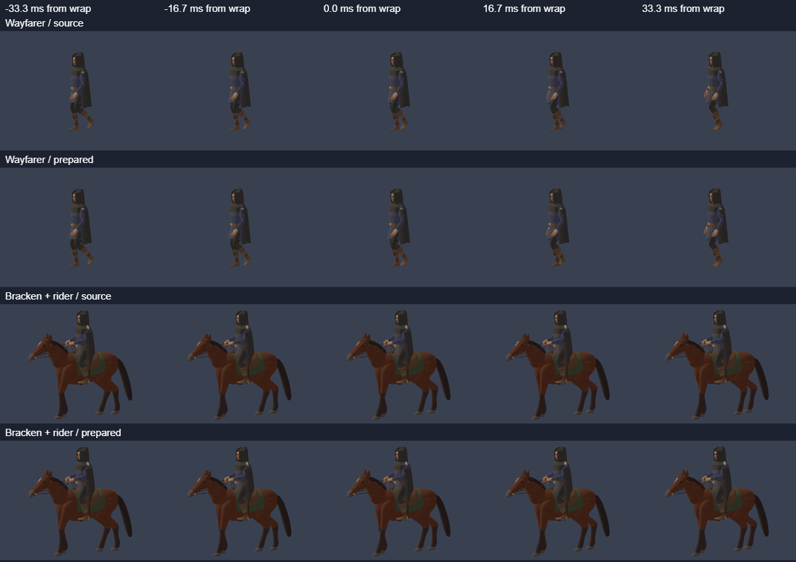

# Chapter One gait continuity

The Wayfarer walk finishes on the correct pose. Its 1.033 s loop still contained a brief stop. All 23 baked cubic tracks had zero incoming and outgoing velocity at the join, including both legs and the moving pelvis. Bracken's 1 s walk had the same issue. Both stops reproduced on the stationary rigs under a regular mixer clock, independently of terrain, input and rendering load.

## Playback changes

`src/runtime/three/threeCharacterAnimation.ts` joins the incoming and outgoing slopes on the cached playback copies of the Golden walk and HorseWalk. Each component uses the harmonic mean of its neighbouring slopes when they point in the same direction. A turning point retains its zero tangent. The operation preserves the duration, key times, poses and all interior handles. The immutable GLBs and editing contracts have their original data.

A separate controller defect restarted the walk action when a character without a distinct run clip switched between walking and sprinting. The controller now updates the semantic state and playback rate while that same action keeps its phase. The Wayfarer has a distinct run clip, so this compatibility fix does not explain its once-per-stride pause. Full gaits still crossfade for 120 ms. Explicit cinematic restarts and combat one-shots keep their existing behaviour.

## Stationary rigs

The deterministic check advances a real Three mixer for 1,200 updates at 60 Hz for each source/prepared pair. The table reports the maximum 60 Hz step anywhere in the cycle and peak acceleration during the interval extending 33.3 ms to either side of the join. Finite differences use 240 Hz samples. Measurements use the pelvis and ankles on the Wayfarer and the saddle and four pasterns on Bracken. Distances are in the installed rig's world units with an identity wrapper. The comparison at source key times found zero positional differences across the sampled joints in all five cases.

| Clip | Period (s) | Wraps in 20 s | Max joint step, source → prepared | Peak acceleration near join, source → prepared (units/s²) |
| --- | ---: | ---: | ---: | ---: |
| Wayfarer walk | 1.033 | 19 | 0.0649 → 0.0573 | 265.5 → 75.9 |
| Wayfarer run | 0.667 | 29 | 0.0644 → 0.0644 | 305.7 → 305.7 |
| Bracken walk | 1.000 | 20 | 0.0346 → 0.0305 | 147.8 → 113.9 |
| Bracken canter | 0.600 | 33 | 0.0695 → 0.0695 | 237.5 → 237.5 |
| Seated ride | 0.800 | 24 | 0 → 0 | 0 → 0 |

The Wayfarer's left ankle approached and left the wrap at 0.014/0.015 units/s in the source and 2.573/2.574 units/s after preparation. The pelvis changed from 0.002/0.001 to 0.211/0.210. The seated clip holds the pelvis and ankles while its upper body moves. Running is pose-continuous at the join. Its linear samples have differing incoming/outgoing ankle speeds. A trial applying the Bracken walk correction to canter increased peak acceleration from 237.5 to 310.5 units/s, so canter retains its authored interpolation.

Chrome rendered the original and prepared Wayfarer and mounted Bracken in adjacent viewports for 20 seconds on the Intel Iris Xe using D3D11. Each pair shared the same camera and animation time. The before/after poses coincide at the wrap. The approaching and departing steps change subtly. The five matched frames below use the real meshes and textures, from −33.3 to +33.3 ms. The isolated fixture also exercises the production saddle attachment. A contact sheet provides limited evidence about human perception during play.



## Entering and leaving gaits in Merewatch

The following paired observations used the Chapter One save checkpoints, scripted input, Chrome 158, Iris Xe D3D11, 960 × 600 viewport and DPR 1. Each build had its own browser launch. The held W route lasted 1.65 s. The mounted route alternated right/left/right/left with four 750 ms holds. These instrumented runs isolate gait behaviour. The separate full-route trials in the transition/scaling report measure general frame pacing.

| Observation | Reference `72c6256` | Gait candidate |
| --- | ---: | ---: |
| Held walk, moving poses / wrap crossings | 64 / 1 | 76 / 1 |
| Held walk, phase steps backwards by >50 ms | 0 | 0 |
| Held walk, largest absolute phase step | 33.3 ms | 33.3 ms |
| Ride, moving poses / estimated wrap crossings | 214 / 3 | 211 / 3 |
| Ride, phase steps backwards by >50 ms | 3 | 1 |
| Ride, greatest horizontal/vertical pelvis-to-seat error | < 5 × 10⁻¹⁶ units | < 6 × 10⁻¹⁶ units |
| Ride, frame interval p50 / p95 / p99 / worst | 12.5 / 16.7 / 16.8 / 20.8 ms | 12.5 / 16.8 / 20.5 / 20.8 ms |
| Ride, frames exceeding 50 ms | 0 / 241 | 0 / 240 |
| Ride, sampled GPU median | 11.6 ms | 12.1 ms |
| Ride, mean render / animation callback subphase | 3.2 / 0.2 ms | 3.6 / 0.3 ms |

The held walk continued advancing across the boundary on both builds. The mounted phase estimates reverse briefly during a route with three direction changes and idle/gait blends. They provide no evidence of an improving mounted frame rate. The pelvis stayed attached throughout. The historical regression from 16.6 to 20.8 ms at p95 was observed again on the full-route reference at 20.8 ms, while the isolated reference above reached 16.7 ms. In the historical pair the worst render submission rose from 5.7 to 21.2 ms and worst animation update from 0.4 to 0.5 ms. The present full-route reference recorded 22.4 ms and 0.5 ms respectively. Render and GPU work account for most of the measured cost. The captures cannot isolate a unique cause for variation between runs.

An additional controlled trial switched only the static shadow cache on the same mounted route. Four fresh launches ran in native, cached, cached, native order. Native shadow draws per update were 310 in both runs, with frame p95 of 21.0 and 20.9 ms and GPU medians of 17.2 and 12.6 ms. Cached shadow draws were 122, with frame p95 of 12.7 and 12.6 ms and GPU medians of 8.4 and 9.0 ms. The first cached run still had the longest individual frame, 33.3 ms. This isolates a benefit from enabling the cache in this view. The historical mounted regression therefore needs an explanation beyond the change in shadow strategy, and headroom continues to vary between launches.

There is residual foot sliding. On the prepared straight walk, 52 consecutive-frame ankle samples in the lowest 15% of that ankle's vertical range had a median horizontal world speed of **2.48 units/s**. There is no authored ground-contact annotation, and an ankle can move while the toe bears weight. This is a stance proxy and a candidate-only measurement. The corrected tangent preserves every contact key's time and position. Perfect foot locking would require calibrating the authored stride and playback rate against world travel, or an explicit contact solution. Increasing the global playback rate would alter all movement states.

## Reproduction

Run from the repository root. These commands use the opt-in benchmark harness and the same Chapter One project as the transition route.

```powershell
node tools/profile-hollow-gaits.mjs
$env:HOLLOW_CHROME_PATH = 'C:\Program Files\Google\Chrome\Application\chrome.exe'
$env:HOLLOW_ANGLE = 'd3d11'
$env:HOLLOW_OFFLINE_ROUTE = '1'
node e2e/hollow-runtime-baseline.mjs test-results/chapter-build test-results/gait-film --view-gaits chapter-one
node e2e/hollow-runtime-baseline.mjs test-results/chapter-build test-results/gait-walk --play-session --walking-only --observe-gaits chapter-one
node e2e/hollow-runtime-baseline.mjs test-results/chapter-build test-results/gait-ride --play-session --mounted-only --observe-gaits chapter-one
node e2e/hollow-runtime-baseline.mjs test-results/chapter-build test-results/ride-native --play-session --mounted-only --native-mounted-shadows chapter-one
node e2e/hollow-runtime-baseline.mjs test-results/chapter-build test-results/ride-cached --play-session --mounted-only chapter-one
npm.cmd run test:run -- src/runtime/three/threeCharacterAnimation.test.ts src/runtime/three/vehiclePresentation.test.ts
```

The film command bundles the current checkout's preparation helper and plays both decoded source and prepared clips. The gameplay commands drive the specified test-mode Vite build. The opt-in observer reads the displayed rig's local rotations against the shipped keys. It records the observed gait phase to the nearest key, which limits temporal resolution to about 33 ms for walking. Idle blends and reversals can also change the nearest matching pose. The controller test counts actual reset calls across a 20-second hold and two fallback switches. Use an uninstrumented route for headline frame timing.
