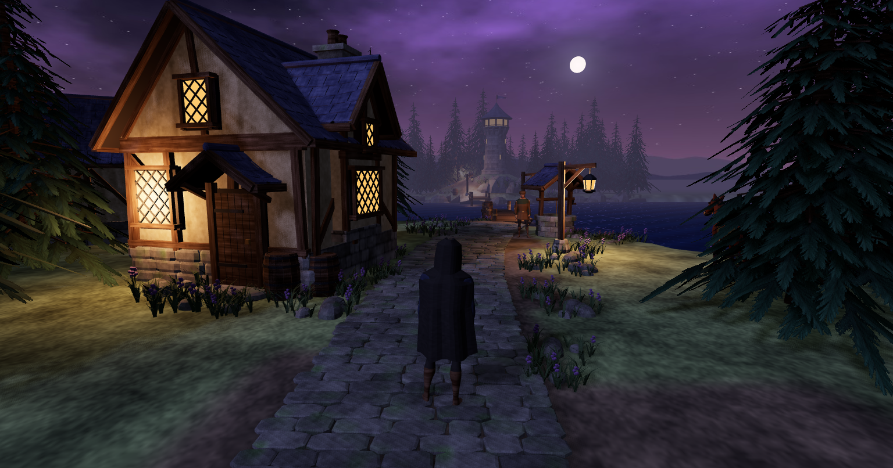
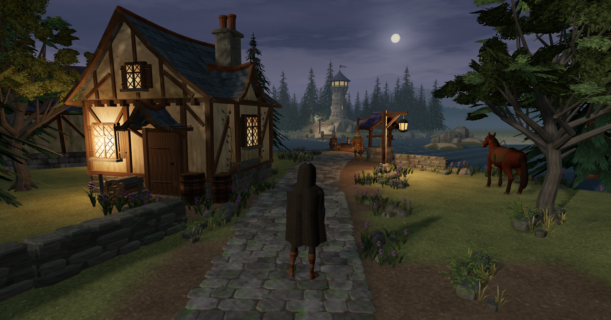
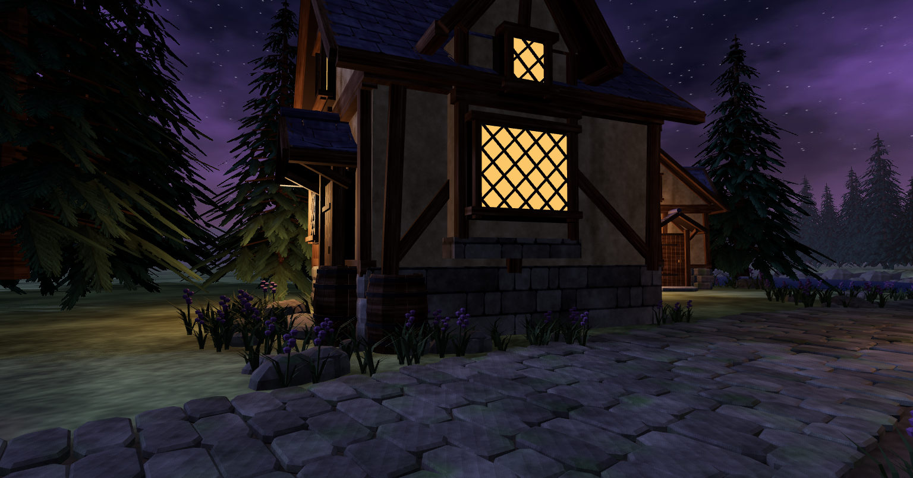
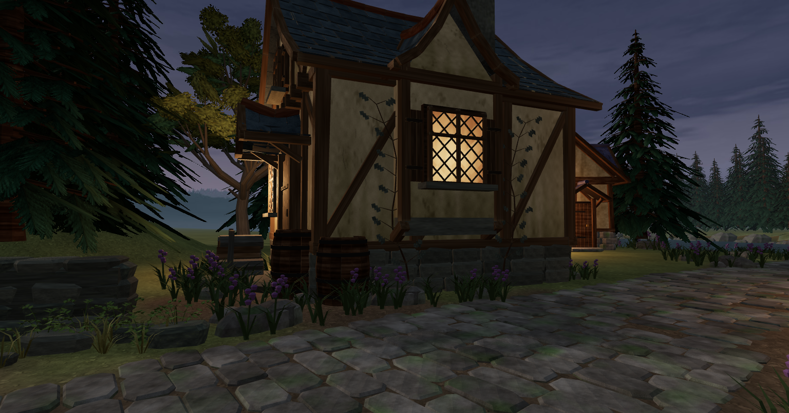
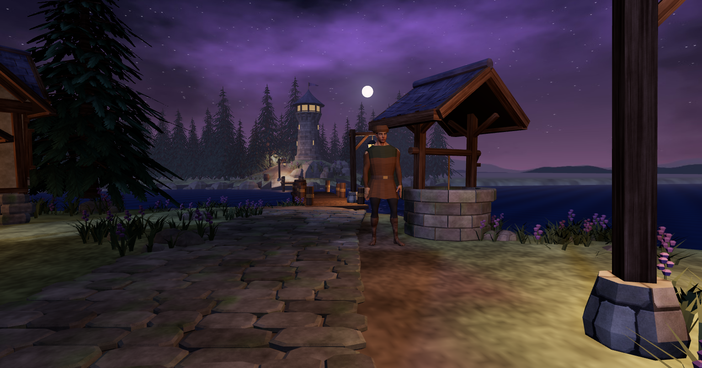
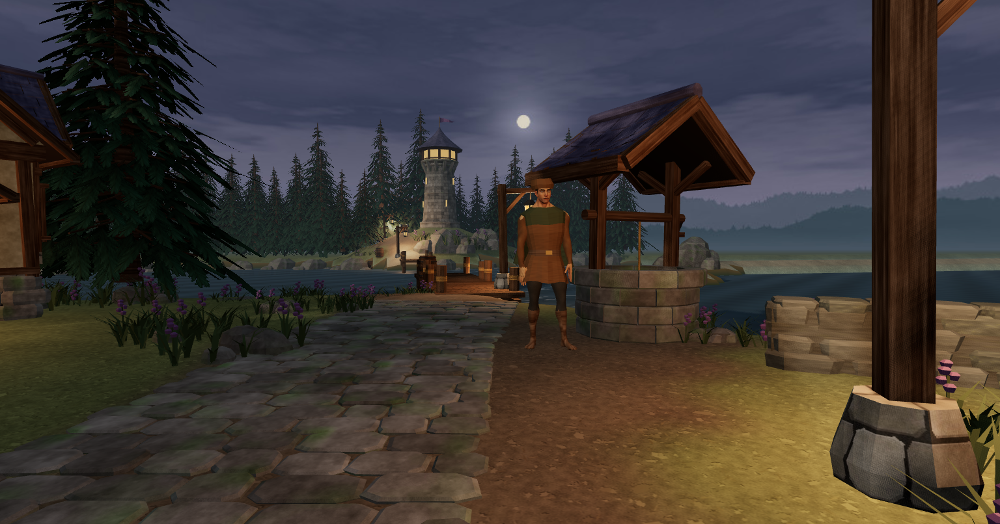
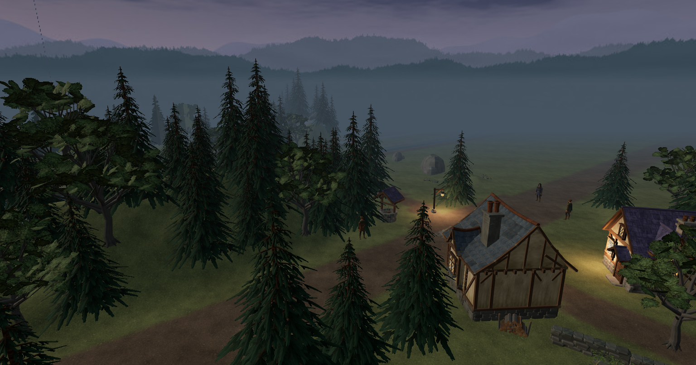
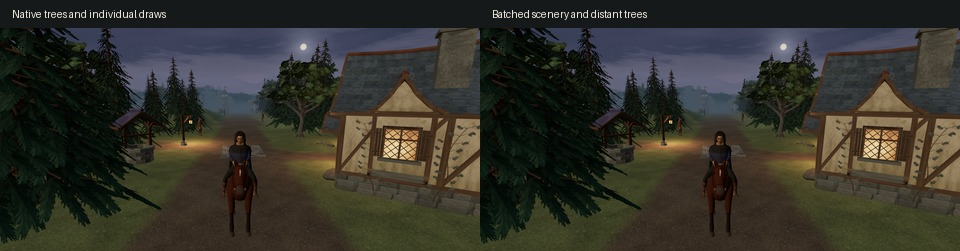

# Merewatch by Lamplight

The largest configuration to pass both a measured traversal and a lower-overhead repeat was **154 × 200 tiles, 1,209 placed objects and twelve NPCs**. That is 11.7 times Merewatch's map area and 2.9 times the earlier 88 × 120 baseline. The return view included 1,067 submitted placement IDs and all fourteen player, mount and NPC characters. At 198 × 200 the lower-overhead run missed the target when the player turned to look back across the valley. The revised village also missed the same frame budget at the higher gallery resolution.

## Play the two environments

From the experiment checkout, start the editor with `npm run dev`. On Home, import [merewatch-field-study.project.json](../../merewatch-field-study.project.json), open **Map Editor → 3D View → Play**, and walk north from the cottage to Oswin’s well. The original village is [hollow-kingdom.project.json](../../hollow-kingdom.project.json). The reference project is a separate authored project with its own name and all the original village interactions.

For the continuous landscape, import [merewatch-vale.project.json](../../merewatch-vale.project.json) the same way. This build of the Green Road has 16,500 cells, 628 placed objects and eight NPCs. Follow the road to Bracken, press **E** to mount, and continue to the far watch. The cross-lanes lead to the water, the causeways and the higher woodland. To regenerate it, use a new output filename.

```powershell
node tools/hollow-kingdom/field-study/fixture.mjs stress green-road-stress.project.json
```

The [154 × 200 landscape](../../merewatch-frontier.project.json) is also ready to import. To reproduce that version, replace `stress` with `frontier` and choose a fresh output filename.

## Comparison and art direction

The controlled route runs from the cottage at (16, 48) to the well at (24, 41), with the beacon across the water as its distant landmark. The reference look comes from the repository’s [cottage lane](../assets/hollow-kingdom/cottage-lane.png) and [watchtower from the dock](../assets/hollow-kingdom/watchtower-from-dock.png). The original Gothic 3 manual’s Myrtana illustration shows how low plants, substantial tree trunks and a clearing can give a path depth at eye height. It informed the vegetation comparison. All new meshes, textures and layouts are original to this experiment. [Gothic 3 manual, pp. 34–35](https://shared.fastly.steamstatic.com/store_item_assets/steam/apps/39500/manuals/G3_Manual_UK.pdf#page=18)

| View | Original Merewatch | Revised Merewatch |
| --- | --- | --- |
| Arrival |  |  |
| Cottage threshold |  |  |
| Oswin’s well |  |  |

These six frames come from the Play renderer at 1536 × 806, with identical lens, camera positions and orientations for each pair. One step of regular movement turns the Wayfarer toward the beacon. The first camera holds the third-person spawn pose. The other two are fixed eye-height viewpoints. Both projects use native individual draws in this comparison, isolating the art change.

The revised cottage has an overhanging gable, projecting joists, a dipped roof edge, twin chimney pots and a shutter casting a shadow onto mottled plaster. The drystone return and wood store mark the edge of the dwelling. The lighter ash canopy opens a sightline to Bracken. The first iteration exposed gaps between the wall courses and a hard diagonal edge across the lake. Tightening the stone courses and moving the knoll away from the map boundary resolved both in the final frames. Removing the additional gate lamp keeps the lit window as the foreground focus. Close views still reveal the polygonal forks in the ash and the repetitions in the old cobbles and flower groups.

### Cost of the cottage lane

The revised area has 157 objects and three NPCs compared with 136 objects and three NPCs in canonical Merewatch. These three-second samples use the full 1536 × 806 drawing buffer. Each cell below gives main-camera draws, submitted triangles and browser frame-interval p95. The integrated renderer uses the same draw cameras. For the two fixed viewpoints, distant-tree selection remains relative to the active player camera. The landscape traversal below uses the active camera for both drawing and detail selection. [Frame counts, GPU samples, camera transforms and image hashes](merewatch-lane-measurements.json)

| View | Original art, native | Revised art, native | Revised art, instancing + distant trees |
| --- | ---: | ---: | ---: |
| Arrival | 450 / 447,872 / 41.5 ms | 502 / 493,605 / 50.1 ms | 322 / 447,569 / 37.7 ms |
| Threshold | 230 / 255,486 / 37.7 ms | 232 / 273,680 / 54.2 ms | 126 / 282,047 / 41.8 ms |
| Well | 316 / 304,840 / 45.8 ms | 357 / 320,257 / 41.7 ms | 231 / 292,846 / 37.6 ms |

At the threshold, a spatial batch intersects the camera even when some of its members are outside the view. Submission falls by 106 draws but **increases by 8,367 triangles**. All three revised high-resolution views missed the 33.4 ms p95 budget. This higher-resolution result limits what can be inferred from the smaller landscape benchmark surface.

At the end of the walk, accessible resident material texture handles represented 52.7 MiB for the original, 56.5 MiB for native revised art and 57.5 MiB for the optimized revision if counted as four bytes per base-level texel. This is a partial estimate. Mip levels, shader-injected detail maps, skeletons, render targets, driver compression and other GPU allocations affect actual residency. The corresponding Three texture counters at the arrival view were 85, 94 and 93.

## The Green Road

The importable landscape follows a graded coach road between hamlets. A tributary, exposed rock, causeways, an orchard and winding towpath occupy the lower side of the valley. A wooded ridge runs behind the cottages. The generator uses the same cottage, ash, dyke, woodpile and bank as the village, with density controlled by slope, distance to water and proximity to settled ground. The NPCs stand clear of the road. The editor caps each map axis at 200, so the largest generator settings are 154 × 200 and 198 × 200.



The [entrance at player height](../assets/merewatch-field-study/vale-entrance.png) shows Bracken and the first lit cottage. The [causeway from above](../assets/merewatch-field-study/vale-causeway.png) shows the sawtooth bank formed by rows of square water cells.

### Renderer comparison on the Green Road

The performance target was 30 Hz. Each of six phases had to record at least 30 frame intervals, p95 at or below 33.4 ms and p99 at or below 50 ms. The phases were a walk, a mounted ride, a camera orbit, the ride to the far end, a return turn and a stationary view back down the valley. Cold load and warm re-entry were timed separately. All runs used an i9-13900H, 64 GiB RAM, Intel Iris Xe with D3D11 driver 32.0.101.5768, Chrome 158.0.8127.37 and device pixel ratio 1. The 960 × 600 browser window gave the game a **960 × 446** drawing buffer.

Each timing cell gives the **highest phase p95 / highest phase p99** in milliseconds. These can occur in different phases. The first two modes measured the draw list, GPU and shadows. The repeat timed the same route with those extra probes disabled. A dash indicates an unmeasured combination. The final column counts distinct placements submitted to the main camera in the optimized return vista, including members of visible cells.

| Size | Placed objects / NPCs | Native p95 / p99 | Instancing + distant trees p95 / p99 | Lower-overhead repeat p95 / p99 | Submitted placements |
| --- | ---: | ---: | ---: | ---: | ---: |
| 66 × 90 | 192 / 4 | 20.5 / 21.0 | 16.8 / 20.9 | — | 186 |
| 88 × 120 | 364 / 6 | 29.2 / **87.6** | 25.0 / 29.3 | — | 330 |
| 110 × 150 | 628 / 8 | **41.7** / 45.8 | 33.3 / 33.4 | 25.0 / 33.3 | 558 |
| 132 × 177 | 902 / 10 | — | 29.3 / 37.5 | 33.4 / 37.6 | 833 |
| **154 × 200** | **1,209 / 12** | **50.1 / 54.2** | **25.2 / 33.4** | **33.4 / 37.6** | **1,067** |
| 198 × 200 | 1,560 / 16 | — | **41.5** / 45.9 | **37.5** / 50.0 | 1,297 |

At 154 × 200 individual draws missed four phases. In the return vista, the native renderer submitted 2,553 draws and 3,890,782 triangles at 45.9 ms p95. The optimized renderer submitted 1,277 draws and 1,439,090 triangles at 25.0 ms p95. Both modes used the same project, lighting, lens, route and drawing buffer. The lighter probe repeat measured 21.0 ms p95 for that view. Times vary between runs and between differently planted routes. [Machine-readable phase results and geometry counts](merewatch-field-study-data.json)



The matched 110 × 150 images retain the shape of the foreground spruce, the open strip of road and the lit cottage. The substitutions occur mainly in the fogged tree line. At this viewpoint, individual draws submitted 2,062,855 triangles in 1,444 calls. Grouping scenery by material and cell reduced that to 921 calls but raised geometry to 2,193,616 triangles because any visible part can submit the cell. Adding the distant tree models lowered both to **829 calls and 941,846 triangles**. Each call count covers the main camera. The sun's depth pass is measured separately.

The native run missed the walk and short ride budgets. Instancing alone still missed the walk. The combined renderer passed all six phases in both runs. At the stationary vista the native run actually had a lower p95 than the instrumented combined run, 25.2 ms versus 29.2 ms. The lower geometry cost makes a measurable difference across traversal, while any one viewpoint can be faster with the original renderer.

In that same vista, the native draw list included 527 placement IDs. Both cell renderers submitted 558. Dynamic shadow updates averaged 149 draws in native mode, 104 with instancing and 72 with distant trees enabled. CPU time per shadow update was 1.61, 1.23 and 1.62 ms, respectively. Three counted 167 native textures, 167 with instancing and 169 with the two additional tree atlases. GPU p95 for the complete frame was 22.44, 30.55 and 27.15 ms. These GPU timings overlap the CPU measurements.

At 154 × 200, optimized cold Play entry took 3.19 s, the following 30 frames took 1.03 s, and warm re-entry took 1.57 s. JavaScript heap after garbage collection rose from 50.09 MiB native to 52.05 MiB optimized. In the return vista, 626 trees used their distant meshes. GPU p95 fell from 36.78 ms (eight samples) to 21.41 ms (thirteen). Each shadow update fell from 163 draws and 2.39 ms CPU time to 79 draws and 1.27 ms. At 198 × 200 the lighter run missed on the stationary return view, while the instrumented run missed on the walk and short ride. The measurements leave the exact cutoff between those sizes open.

The archived 88 × 120 world is a separate calibration with 489 objects, twelve NPCs and different scenery. Rerunning that exact archived project on a fresh build of the experiment's parent revision, `f985459`, submitted 1,206 draws and 1,417,918 triangles during the far ride, with a p95 of 46.0 ms and p99 of 50.2 ms. The [earlier run](HOLLOW_KINGDOM_WORLD_SCALE.md) recorded 21.1 and 29.3 ms on that leg. The Green Road's own 88 × 120 version contains 364 objects and six NPCs. Only comparisons between renderer modes on the same project hash isolate the rendering change.

## What another area can reuse

| Class | What is reusable | How to use it |
| --- | --- | --- |
| A · Existing engine and assets | Shared imported-project schema, isolated Play session, transformed collision profiles, cached GLTF loader, third-person controls, smooth terrain, water, fog overrides, editor selection and transforms. Bracken, the well, watchtower, spruce and main cast come from the existing kit. | Assign asset IDs to object definitions and place instances in the Map Editor. Keep individual IDs for editing, interaction and save state. |
| B · Compatible extensions | The optional area atmosphere accepts `blue-hour`. Five environment registry IDs describe the new village pieces. The solid pieces have traversal profiles. Fixed props can opt in via `static-scenery`, and a registry entry can declare a `distantModel`. | Choose **Blue Hour** for an area, choose assets from the existing catalog and set position, rotation and scale. Ship the asset files and registry entries in the editor build that imports the project. |
| C · Reusable rendering and generation | Spatially grouped instancing for eligible static Play markers, a seeded material/geometry kit, a reusable sky and terrain detail treatment, and a deterministic landscape authoring script. | Edit dimensions and seeds in [settings.py](../../tools/hollow-kingdom/cottage-lane/settings.py). Preserve the authored origin and forward axis when replacing a mesh. The [landscape generator](../../tools/hollow-kingdom/field-study/landscape.mjs) places terrain and keeps the road, settlement footprints, watercourse and population clearances related to one another. |
| D · Merewatch-specific work | The cottage replacement, hand-placed drystone returns, firewood, lantern, well apron, verge planting, cobble adjustments, two knolls and composition toward the existing beacon. | These placements and original entity IDs live in [village.mjs](../../tools/hollow-kingdom/field-study/village.mjs). A new area can start with the kit and its own layout. |

The registry holds model URLs, visual capabilities and traversal profiles in application code. Project JSON carries assignments and transforms, so copying a new environment GLB beside an exported project does not register it in another checkout. Static batching uses asset metadata and the actual resolved mesh, materials, interaction and behavior to decide eligibility. Runtime actors and light-bearing cottage hierarchies stay individual. Editing remains per placement in the Map Editor. Generated terrain and props become ordinary authored cells and placements on import. Subsequent generator changes do not merge with manual edits.

## Art kit and editing boundary

| Near asset | Triangles | Material primitives | GLB bytes |
| --- | ---: | ---: | ---: |
| Chandler’s cottage | 11,507 | 2 | 1,047,972 |
| Wind-pruned ash | 3,842 | 2 | 362,852 |
| Fern and schist bank | 2,503 | 1 | 246,172 |
| Drystone dyke | 1,332 | 1 | 136,612 |
| Split firewood | 472 | 1 | 103,736 |

The five near GLBs total 1,897,344 bytes. The original cottage had 5,756 triangles across nine primitives. The revised cottage spends geometry on the projecting frame and roof while using two atlas-backed primitives. Its hearth remains a real punctual light. The atlas maps, geometry parts and lighting settings are packed into [the five-scene Blender source](../../tools/hollow-kingdom/cottage-lane/merewatch-lane.blend). The generator re-imported every export, checking triangle and material counts, embedded maps, vertex colors, UVs, light counts and transformed bounds within 2 mm. An independent second bake reproduced all five GLBs byte for byte.

The separate far spruce and ash each use 12 triangles and one masked material. The [impostor baker](../../tools/hollow-kingdom/field-study/bake_foliage.py) projects the corresponding authored GLB from three directions. At a 64-pixel tree height, silhouette intersection-over-union was 0.94–0.97 at captured angles and 0.77–0.82 halfway between views. The ash crown looks denser between views. Hysteresis keeps small camera movements from repeatedly switching a cell. A proxy does not reproduce branch parallax or the source mesh’s lighting at every azimuth.

The editor check returned from Play to the 3D Map Editor, selected two separate wall placements and edited only the first. Its X position changed from 16.45 to 16.7. The other wall stayed at 15.16 and Undo restored the first to 16.45. The gameplay check walked from the authored spawn past the cottage on both projects. The fixture tests separately check shared traversal, story, cinematic, dock and mount data.

```powershell
python tools/hollow-kingdom/cottage-lane/paint.py
blender -b --python-exit-code 1 -P tools/hollow-kingdom/cottage-lane/build.py
python tools/hollow-kingdom/field-study/atmosphere.py
python tools/hollow-kingdom/field-study/bake_foliage.py
```

Use Blender 5.2, Python, Pillow and NumPy. The dome and ground detail use one 3072 × 640 panorama and a repeating four-metre patch. The runtime combines the pre-baked detail with the existing per-map terrain raster.

For a cottage variant, start from the packed cottage scene or change its footprint, eaves and ridge in `settings.py`. Reuse the plaster, oak, slate and stone atlas slots. Export under a new asset ID, check its door orientation and collision envelope, then place it using the same layout helpers. For a tree variant, keep the root at ground level, generate the distant model in the same local coordinates, and reference it from the near model’s registry entry. The transition uses the *nearest edge* of each complete batch’s bounds, switching out beyond 44 metres and back inside 39. Full-detail shadow depth remains available for lights that need it. The Map Editor always retains the near assets.

### Remaining limits

- **Settlement and shore detail.** The same secondary cottage, well, windows and roadside plant groups become recognizable from one hamlet to the next. The causeway and waterline expose the underlying grid from above. The new kit gives artists reusable pieces, but the experiment covers one building family and one biome.
- **Visibility and memory.** Batches use a 12-metre grid. Each submitted cell can draw every instance it contains. Close occlusion is still handled by the normal depth buffer. The whole map, source markers and collision data remain resident. Encoded GLB size and JS heap do not measure driver memory.
- **Animation and population.** The scale route exercises moving player and mount among idle NPCs. It does not establish a budget for crowds, concurrent combat, interiors, cinematics or simultaneous AI navigation. Character meshes and materials retain the existing art direction.
- **Authoring scale.** Registry changes still require an application build. The import limit is 200 tiles per axis. Generating a larger single project is separate from persistent streaming or stitching regions together. The benchmark establishes performance inside the tested authored areas.
- **Display target.** The landscape frame budget applies to the measured GPU, drawing buffer and camera route. The larger gallery view misses 30 Hz in the revised village. A 1080p/60 target needs its own measurements and budget.

## Reproduce the browser measurements

The runner imports a new project in Chromium, enters Play, waits for asset and terrain readiness, walks to the horse, mounts, rides, orbits, completes the road and turns back to look across the entire valley. Travel uses actual keyboard input. The far view matters because the camera can see many more trees, actors and lights than during a short walk from the spawn. Browser JS, project data and assets are served from the same files in both rendering modes.

```powershell
node --input-type=module -e "import {build} from 'vite'; await build({mode:'test',build:{outDir:'test-results/field-build',copyPublicDir:false}})"
$env:HOLLOW_CHROME_PATH = 'C:\Program Files\Google\Chrome\Application\chrome.exe'
$env:HOLLOW_ANGLE = 'd3d11'
$env:HOLLOW_OFFLINE_ROUTE = '1'
node e2e/hollow-runtime-baseline.mjs test-results/field-build test-results/scales --field-study --list
node e2e/hollow-runtime-baseline.mjs test-results/field-build test-results/native --field-study --unbatched --world-views stress
node e2e/hollow-runtime-baseline.mjs test-results/field-build test-results/instanced --field-study --instances-only stress
node e2e/hollow-runtime-baseline.mjs test-results/field-build test-results/distant --field-study --world-views stress
node e2e/hollow-runtime-baseline.mjs test-results/field-build test-results/repeat --field-study --world-pacing-only stress
node e2e/hollow-runtime-baseline.mjs test-results/field-build test-results/distant --field-study frontier reach
node e2e/hollow-runtime-baseline.mjs test-results/field-build test-results/repeat --field-study --world-pacing-only frontier reach
node e2e/field-study-summary.mjs test-results/scale-comparison.json test-results/native test-results/instanced test-results/distant test-results/repeat
node e2e/hollow-runtime-baseline.mjs test-results/field-build test-results/gallery-native --lane-gallery --unbatched merewatch merewatch-art
node e2e/hollow-runtime-baseline.mjs test-results/field-build test-results/gallery --lane-gallery merewatch-art green-road
```

Use separate output directories for each repetition. The native and instance-only overrides apply only to test-mode builds. The published scale [measurement file](merewatch-field-study-data.json) records the device, output surface, build and art fingerprints, project hashes, frame counts, all action percentiles and pass/fail for each attempt. Driver VRAM was unavailable. The evidence distinguishes post-GC JavaScript heap, Three texture counts and material texture estimates.

## Validation

The final `npm run ci` passed all 1,111 Vitest tests across 141 files, the root and Studio production builds, the three package typechecks and all 78 compiler tests. Scoped Biome checks passed. Regeneration reproduced the checked-in village and both importable landscape projects after parsing. Canonical Merewatch retained its original file hash. The browser evidence covers fifteen official scale runs, a fresh historical calibration, three setup trials and the separate matched-camera gallery.
